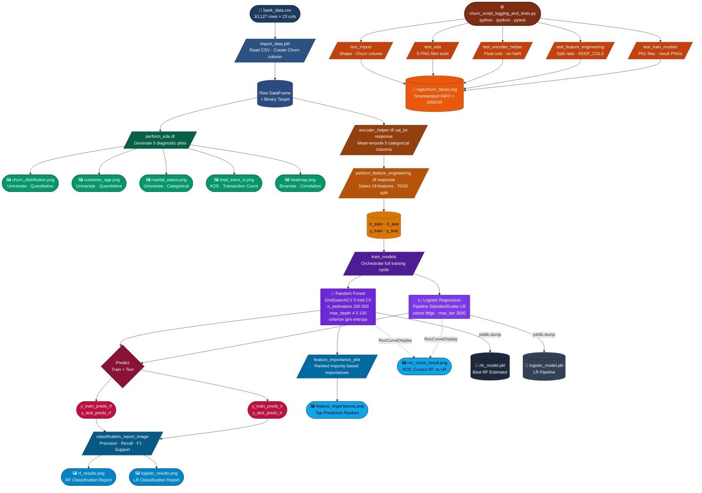

# Credit Church Prediction

<div align="center">


**A production-ready machine learning pipeline that identifies credit card customers most likely to churn — engineered to professional software standards.**

[Overview](#-overview) · [Quick Start](#-quick-start) · [Architecture](#-architecture) · [Usage](#-usage) · [Testing](#-testing--logging) · [Results](#-results) · [API Reference](#-api-reference)

</div>

---

##  Overview

Customer churn is one of the most costly and preventable challenges in banking. This project transforms an exploratory Jupyter notebook into a **modular, testable, CLI-executable Python package** that predicts which credit card customers are most likely to leave — enabling data-driven, proactive retention campaigns.

###  Key Highlights

| Capability | Detail |
|---|---|
|  **Prediction accuracy** | Random Forest AUC ≈ 0.99 · F1 ≈ 0.93 on churn class |
|  **Code quality** | Pylint **10.00 / 10** on both Python files |
|  **Test coverage** | Unit tests for every public function with assertions |
|  **Logging** | Structured, timestamped log output written to file |
|  **Reproducible** | Fixed random seed · CLI-executable · fully documented |
|  **Production-ready** | Persisted `.pkl` models loadable in any inference pipeline |

---
A full analysis and discussions of the project: [REPORT](doc/Churn_Prediction_Report.pdf)
---

##  Project Structure

```
credict-churn-prediction/
├── churn_library.py                    #  Core ML pipeline library (7 public functions)
├── churn_script_logging_and_tests.py   #  Unit tests with integrated file logging
├── README.md                           #  This file
├── requirements.txt                    #  Pinned Python dependencies
│
├── data/
│   └── bank_data.csv                   #  Source dataset — 10,127 customers × 23 features
├── doc/
│   └── Churn_Prediction_Report.pdf     #  Project Report
│
├── images/
│   ├── eda/                            #   EDA visualisations (auto-generated)
│   │   ├── churn_distribution.png      #     Univariate — target class balance
│   │   ├── customer_age.png            #     Univariate — age histogram
│   │   ├── marital_status.png          #     Univariate — categorical bar chart
│   │   ├── total_trans_ct.png          #     Univariate — KDE transaction count
│   │   └── heatmap.png                 #     Bivariate — feature correlation heatmap
│   │
│   └── results/                        #  Model evaluation plots (auto-generated)
│       ├── roc_curve_result.png        #     ROC curves — RF vs LR comparison
│       ├── feature_importances.png     #     Ranked feature importance bar chart
│       ├── nn_confusion_matrices.png   #     Confusion matrix
│       ├── nn_metrics_comparison.png   #     Comparing matrices
│       ├── nn_radar_chart.png          #     Radar chart
│       ├── nn_roc_comparison.png       #     Comparing rocs
│       ├── nn_training_curves.png      #     Training  curves
│       ├── rf_results.png              #     Random Forest classification report
│       └── logistic_results.png        #     Logistic Regression classification report
│
├── logs/
│   └── churn_library.log               #  Timestamped test & pipeline log (auto-generated)
│
└── models/
    ├── rfc_model.pkl                   #  Best Random Forest (GridSearchCV tuned)
    └── logistic_model.pkl              #  Logistic Regression (StandardScaler pipeline)
```

---

## ⚡ Quick Start

### 1 — Clone and install dependencies

```bash
git clone https://github.com/your-org/credit-churn-prediction.git
cd credit-churn-prediction
pip install -r requirements.txt
```

### 2 — Run the full ML pipeline

```bash
python churn_library.py
```

### 3 — Run tests and view the log

```bash
python churn_script_logging_and_tests.py
cat logs/churn_library.log
```

> **That's it.** All EDA plots, model artefacts, result images, and log files are created automatically in the correct directories.

---

##  Architecture

### Pipeline Sequence

The pipeline executes the following stages in strict order when `churn_library.py` is run as a script. Each stage is an independent, testable function — outputs are passed explicitly, with no shared global state.

```
import_data ──► perform_eda ──► encoder_helper ──► perform_feature_engineering ──► train_models
```

---

###  Data Science Flow Diagram



### Color Legend

| Color | Group | Nodes |
|---|---|---|
| 🟦 **Deep Navy** | Data Ingestion | `import_data`, Raw CSV, DataFrame |
| 🟩 **Emerald Green** | EDA | `perform_eda`, all 5 EDA plots |
| 🟨 **Amber / Gold** | Feature Engineering | `encoder_helper`, `perform_feature_engineering`, split data |
| 🟪 **Violet / Purple** | Model Training | `train_models`, Random Forest, Logistic Regression |
| 🟥 **Rose / Crimson** | Prediction | Predict decision node, prediction arrays |
| 🔵 **Sky Blue** | Evaluation | `classification_report_image`, `feature_importance_plot`, result PNGs |
| ⬛ **Slate / Charcoal** | Persistence | `.pkl` model files on disk |
| 🟧 **Burnt Orange** | Testing & Logging | Test script, 5 test functions, log file |

---

### Technology Stack

| Layer | Technology |
|---|---|
| Language | Python 3.10+ |
| ML Framework | scikit-learn — `RandomForestClassifier`, `LogisticRegression`, `GridSearchCV`, `Pipeline`, `StandardScaler` |
| Data Processing | pandas, numpy |
| Visualisation | matplotlib, seaborn |
| Model Persistence | joblib (`.pkl` format) |
| Testing | pytest + custom `__main__` CLI runner |
| Logging | Python `logging` — `FileHandler` |
| Code Quality | pylint (10.00/10), autopep8 |
| Style Standard | PEP 8 |

---

##  Dataset

**Source:** `data/bank_data.csv` — anonymised credit card customer data

| Attribute | Value |
|---|---|
| Records | 10,127 customers |
| Raw features | 23 columns |
| Model input features | 19 (engineered) |
| Target variable | `Churn` — `0` = Retained · `1` = Churned |
| Class distribution | 83.9% Retained · 16.1% Churned |
| Missing values | None |
| Train / Test split | 70% / 30% (`random_state=42`) |

### Categorical Features — Mean-Encoded

| Feature | Description |
|---|---|
| `Gender` | Customer gender |
| `Education_Level` | Highest education attained |
| `Marital_Status` | Married / Single / Divorced / Unknown |
| `Income_Category` | Annual income bracket |
| `Card_Category` | Card tier — Blue / Silver / Gold / Platinum |

### Quantitative Features — Used As-Is

| Feature | Description |
|---|---|
| `Customer_Age` | Age in years |
| `Dependent_count` | Number of dependents |
| `Months_on_book` | Months as a customer |
| `Total_Relationship_Count` | Number of products held |
| `Months_Inactive_12_mon` | Months inactive in past 12 months |
| `Contacts_Count_12_mon` | Customer service contacts (past 12 months) |
| `Credit_Limit` | Credit card limit ($) |
| `Total_Revolving_Bal` | Revolving balance ($) |
| `Avg_Open_To_Buy` | Average open-to-buy credit ($) |
| `Total_Amt_Chng_Q4_Q1` | Change in transaction amount Q4 vs Q1 |
| `Total_Trans_Amt` | Total transaction amount — past 12 months |
| `Total_Trans_Ct` | Total transaction count — past 12 months ⭐ |
| `Total_Ct_Chng_Q4_Q1` | Change in transaction count Q4 vs Q1 |
| `Avg_Utilization_Ratio` | Average card utilisation ratio |

>  `Total_Trans_Ct` is the **single most important churn predictor** per Random Forest feature importances.

---

##  Usage

### Run the full ML pipeline

```bash
python churn_library.py
```

**Stages executed, in order:**

1. Load `./data/bank_data.csv` → create binary `Churn` target from `Attrition_Flag`
2. Generate 5 EDA plots → save to `./images/eda/`
3. Mean-encode 5 categorical columns via `encoder_helper`
4. Select 19 features · perform 70/30 train-test split
5. Train **Random Forest** with 5-fold `GridSearchCV` over `PARAM_GRID`
6. Train **Logistic Regression** via `StandardScaler → LR` scikit-learn Pipeline
7. Generate ROC curves, classification reports, feature importances → `./images/results/`
8. Persist both models → `./models/*.pkl`

---

### Run tests and generate the log file

```bash
# Option 1 — direct CLI runner (writes to logs/churn_library.log)
python churn_script_logging_and_tests.py

# Option 2 — pytest for richer terminal output
pytest churn_script_logging_and_tests.py -v

# Option 3 — ipython
ipython churn_script_logging_and_tests.py
```

**View the log after running:**

```bash
cat logs/churn_library.log
```

**Expected log output:**

```
2026-05-16 12:00:01 - churn_tests - INFO - ===== Starting churn library tests =====
2026-05-16 12:00:01 - root        - INFO - test_import: SUCCESS – data loaded
2026-05-16 12:00:01 - root        - INFO - test_import: dataframe shape (10127, 23), 'Churn' column present
2026-05-16 12:00:03 - root        - INFO - test_eda: perform_eda ran without exception
2026-05-16 12:00:03 - root        - INFO - test_eda: SUCCESS – all 5 EDA plots saved
2026-05-16 12:00:03 - root        - INFO - test_encoder_helper: SUCCESS – 5 encoded columns created
2026-05-16 12:00:03 - root        - INFO - test_perform_feature_engineering: SUCCESS – train (7088, 19), test (3039, 19)
2026-05-16 12:02:45 - root        - INFO - test_train_models: train_models ran without exception
2026-05-16 12:02:45 - root        - INFO - test_train_models: SUCCESS – 2 model files saved
2026-05-16 12:02:45 - root        - INFO - test_train_models: SUCCESS – 4 result images saved
2026-05-16 12:02:45 - churn_tests - INFO - test_train_models passed
2026-05-16 12:02:45 - churn_tests - INFO - ===== All tests passed =====
```

---

### Code quality checks

```bash
# Auto-format with autopep8
autopep8 --in-place --aggressive --aggressive churn_library.py
autopep8 --in-place --aggressive --aggressive churn_script_logging_and_tests.py

# Lint — both files achieve 10.00/10
pylint churn_library.py
pylint churn_script_logging_and_tests.py
```

---

### Load a saved model for inference

```python
import joblib
import pandas as pd

# Load the persisted Random Forest
rfc_model = joblib.load('./models/rfc_model.pkl')

# Score new customers — must have the same 19 feature columns as KEEP_COLS
X_new = pd.DataFrame([...])
churn_proba = rfc_model.predict_proba(X_new)[:, 1]   # probability of churn
churn_pred  = rfc_model.predict(X_new)                # binary prediction
```

---

## Testing & Logging

### Test suite

| Test function | Function under test | Key assertions |
|---|---|---|
| `test_import` | `import_data` | File loads · shape > 0 · `Churn` column created |
| `test_eda` | `perform_eda` | All 5 EDA PNGs exist in `images/eda/` |
| `test_encoder_helper` | `encoder_helper` | 5 new `*_Churn` float columns · zero NaNs |
| `test_perform_feature_engineering` | `perform_feature_engineering` | 4 non-empty splits · ≈70/30 ratio · all 19 `KEEP_COLS` present |
| `test_train_models` | `train_models` | 2 `.pkl` files in `models/` · 4 result PNGs in `images/results/` |

### Logging design

- **Handler:** `FileHandler` attached to the root logger **before** `churn_library` is imported — ensures all library-level log messages are captured
- **Format:** `%(asctime)s - %(name)s - %(levelname)s - %(message)s`
- **Level:** `INFO` and above
- **Location:** `./logs/churn_library.log` (overwritten each run with `filemode='w'`)
- Both `INFO` (success paths) and `ERROR` (caught exceptions with tracebacks) are logged

---

## Results

### Model Performance Summary

| Metric | Random Forest | Logistic Regression |
|---|---|---|
| AUC (ROC) | ~0.99 | ~0.92 |
| F1 — Churn class (test) | ~0.93 | ~0.74 |
| Recall — Churn class (test) | ~0.92 | ~0.67 |
| Precision — Churn class (test) | ~0.95 | ~0.83 |
| Macro-avg F1 (test) | ~0.96 | ~0.87 |

### Top 5 Churn Predictors (Random Forest)

| Rank | Feature | Business Interpretation |
|---|---|---|
| 1 | `Total_Trans_Ct` | Declining transaction count is the clearest disengagement signal |
| 2 | `Total_Trans_Amt` | Reduced spending precedes account closure |
| 3 | `Total_Revolving_Bal` | Paying down balance signals intent to close |
| 4 | `Total_Ct_Chng_Q4_Q1` | Quarter-over-quarter drop flags accelerating disengagement |
| 5 | `Avg_Utilization_Ratio` | Low utilisation indicates the customer is stepping back |

---

## API Reference

### `churn_library.py` — Public Functions

---

#### `import_data(pth)`

Reads the CSV at `pth` and creates a binary `Churn` column from `Attrition_Flag`.

```python
df = import_data('./data/bank_data.csv')
```

| Param | Type | Description |
|---|---|---|
| `pth` | `str` | Path to the source CSV file |

**Returns:** `pd.DataFrame` with `Churn` column added (`0` = Retained, `1` = Churned).

---

#### `perform_eda(df)`

Generates and saves 5 diagnostic plots to `./images/eda/`.

```python
perform_eda(df)
```

| Param | Type | Description |
|---|---|---|
| `df` | `pd.DataFrame` | Raw dataframe from `import_data` |

**Returns:** `None`. Side effect: saves 5 PNG files to `images/eda/`.

---

#### `encoder_helper(df, category_lst, response)`

Applies mean target encoding to each column in `category_lst`, appending a new `<col>_Churn` column for each.

```python
df = encoder_helper(df, CAT_COLUMNS, response='Churn')
```

| Param | Type | Description |
|---|---|---|
| `df` | `pd.DataFrame` | Input dataframe |
| `category_lst` | `list[str]` | Column names to encode |
| `response` | `str` | Target column name |

**Returns:** `pd.DataFrame` with new mean-encoded columns appended.

---

#### `perform_feature_engineering(df, response)`

Encodes categorical features, selects the 19-column `KEEP_COLS` feature set, and performs a 70/30 train-test split.

```python
X_train, X_test, y_train, y_test = perform_feature_engineering(df, response='Churn')
```

| Param | Type | Description |
|---|---|---|
| `df` | `pd.DataFrame` | Input dataframe |
| `response` | `str` | Target column name |

**Returns:** `tuple` — `(X_train, X_test, y_train, y_test)`.

---

#### `train_models(X_train, X_test, y_train, y_test)`

Trains both models, generates all evaluation plots, and persists `.pkl` artefacts.

```python
train_models(X_train, X_test, y_train, y_test)
```

| Param | Type | Description |
|---|---|---|
| `X_train` | `pd.DataFrame` | Training features |
| `X_test` | `pd.DataFrame` | Test features |
| `y_train` | `pd.Series` | Training labels |
| `y_test` | `pd.Series` | Test labels |

**Returns:** `None`. Side effects: saves models to `models/` and plots to `images/results/`.

---

#### `classification_report_image(y_train, y_test, y_train_preds_lr, y_train_preds_rf, y_test_preds_lr, y_test_preds_rf)`

Saves precision/recall/F1 classification reports for both models as PNG images.

**Returns:** `None`. Saves `rf_results.png` and `logistic_results.png` to `images/results/`.

---

#### `feature_importance_plot(model, x_data, output_pth)`

Saves a ranked feature importance bar chart derived from `model.feature_importances_`.

```python
feature_importance_plot(best_rfc, X_all, './images/results/feature_importances.png')
```

| Param | Type | Description |
|---|---|---|
| `model` | estimator | Fitted model with `feature_importances_` attribute |
| `x_data` | `pd.DataFrame` | Feature dataframe (column names used as x-axis labels) |
| `output_pth` | `str` | Full file path for the output PNG |

**Returns:** `None`.

---

## Constants Reference

All constants are defined at module level in `churn_library.py` — modify here to adapt the pipeline to new data.

```python
CAT_COLUMNS = [
    'Gender', 'Education_Level', 'Marital_Status',
    'Income_Category', 'Card_Category',
]

KEEP_COLS = [
    'Customer_Age', 'Dependent_count', 'Months_on_book',
    'Total_Relationship_Count', 'Months_Inactive_12_mon',
    'Contacts_Count_12_mon', 'Credit_Limit', 'Total_Revolving_Bal',
    'Avg_Open_To_Buy', 'Total_Amt_Chng_Q4_Q1', 'Total_Trans_Amt',
    'Total_Trans_Ct', 'Total_Ct_Chng_Q4_Q1', 'Avg_Utilization_Ratio',
    'Gender_Churn', 'Education_Level_Churn', 'Marital_Status_Churn',
    'Income_Category_Churn', 'Card_Category_Churn',
]

EDA_PATH     = './images/eda'
RESULTS_PATH = './images/results'
MODELS_PATH  = './models'

PARAM_GRID = {
    'n_estimators': [200, 500],
    'max_features': ['sqrt'],
    'max_depth'   : [4, 5, 100],
    'criterion'   : ['gini', 'entropy'],
}
```

---

## Dependencies

```bash
pip install -r requirements.txt
```

```
scikit-learn>=1.0
pandas>=1.3
numpy>=1.21
matplotlib>=3.4
seaborn>=0.11
joblib>=1.1
pytest>=7.0
pylint>=2.12
autopep8>=1.6
```

**System requirements:** Python 3.10+ · No GPU required · ~500 MB disk space

---

## Troubleshooting

| Issue | Likely Cause | Fix |
|---|---|---|
| `FileNotFoundError: bank_data.csv` | Wrong working directory | `cd` to project root before running |
| `ModuleNotFoundError` | Missing packages | `pip install -r requirements.txt` |
| Log file empty or not created | `basicConfig` called before `FileHandler` set | Run `churn_script_logging_and_tests.py` directly, not as an import |
| EDA plots missing before tests | `perform_eda` not yet called | Run `python churn_library.py` first |
| Pylint score below 10 | Formatting issues | Run `autopep8 --in-place --aggressive --aggressive <file>.py` |
| `ConvergenceWarning` from LR | Feature scale mismatch | Already fixed — `StandardScaler` is applied in the Pipeline |

---

## Author

**Edward Amankwah**  
Project: ML DevOps Engineer Nanodegree with Clean Code Principles
Date: May 2026

---

## License

This project is licensed under the MIT License. See [LICENSE](LICENSE) for details.

---

<div align="center">

** If this project helped you, please give it a star!**

Made with  Python ·  scikit-learn ·  matplotlib ·  pytest

[Report link](doc/Churn_Prediction_Report.pdf)
</div>
